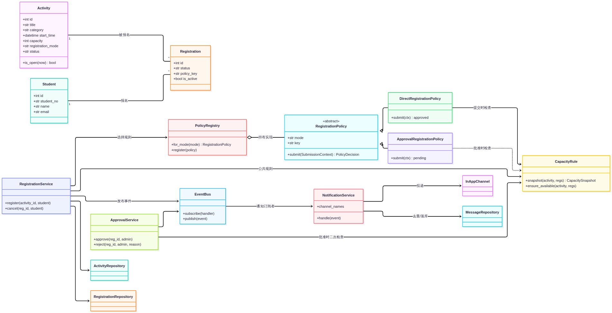
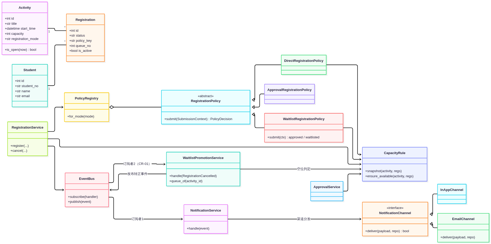

# UML 类图（初版 baseline-v1 与变更版 change-v2）

图由 `docs/diagrams/*.mmd` 生成，渲染脚本：`python tools/render_diagrams.py`。

## 1. 初版类图（baseline-v1）

### 关系说明

| 关系 | 说明 | 体现的设计原则 |
| --- | --- | --- |
| `Activity 1 — * Registration` | 一个活动有多条报名记录 | 关联关系表达领域事实 |
| `Student 1 — * Registration` | 一个学生可报名多个活动 | 同上 |
| `RegistrationService --> PolicyRegistry` | 服务通过注册表**按模式**取策略，不写 `if 活动类型` | 依赖倒置、开闭原则 |
| `PolicyRegistry o-- RegistrationPolicy` | 注册表持有策略实现 | 组合优于继承 |
| `RegistrationPolicy <|-- Direct / Approval` | 两种准入语义 | 策略模式 |
| `DirectRegistrationPolicy --> CapacityRule` / `ApprovalRegistrationPolicy ..> CapacityRule` | 直接报名在提交时检查；审核报名在批准阶段由审批服务检查同一条规则 | 单一职责 + DRY |
| `RegistrationService --> EventBus`，`EventBus --> NotificationService` | 业务只发布事件，通知作为订阅者 | 观察者模式、依赖倒置 |
| `NotificationService --> InAppChannel` / `--> MessageRepository` | 渠道与去重落库 | 接口隔离 |

### 关键设计取舍

1. **实体不做业务判断**：`Activity` 只回答“我还能不能被报名”，剩余名额这类跨实体统计交给 `CapacityRule` + 仓储，避免实体与持久化解耦失败。
2. **`policy_key` 冗余落库**：每条报名记录保存产生它的策略标识，方便审计“这条记录是哪条规则判的”。
3. **不加 `if 名额满` 到 `RegistrationService`**：否则第三种规则（候补）出现时必然要改主流程，反而破坏扩展性。

## 2. 变更版类图（change-v2）

### 相对初版的增量（只列结构变化）

| 变化 | 类型 | 说明 |
| --- | --- | --- |
| `WaitlistRegistrationPolicy` | 新增类 | 第三种报名规则；满员时返回 `waitlisted` 并给出 `queue_no` |
| `WaitlistPromotionService` | 新增类 | 事件总线**第二个订阅者**，监听取消事件完成转正 |
| `NotificationChannel`（接口） | 新增抽象 | 渠道扩展点 |
| `EmailChannel` | 新增类 | 邮件渠道（落盘 `.eml`） |
| `Registration.queue_no` | 新增属性 | 候补位次（非候补为 NULL） |
| `NotificationService.handle` | 修改方法 | 由“只写站内信”改为“遍历渠道投递”，单渠道失败仅留痕 |
| `RegistrationService.register` | 修改 10 行 | 按结果状态选择要发布的**事件类型**（候选补事件），业务判断仍在策略内 |
| `PolicyRegistry.__init__` | 修改 1 行 | 多注册一个策略实现 |

> 具体改动行数与“新增类/修改核心类/回归失败数”等客观指标见 `docs/需求变更影响分析.md`。
