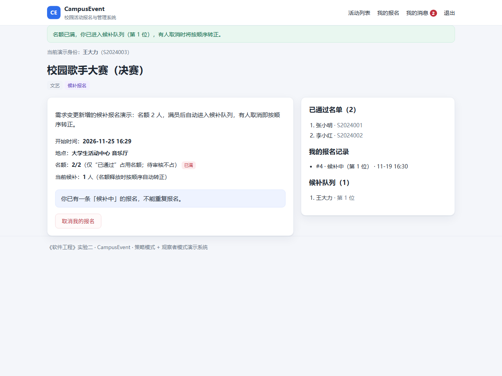
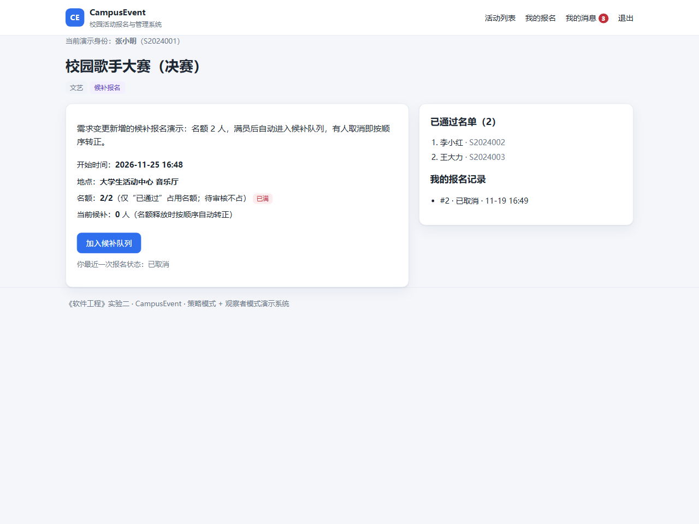

# 《软件工程》实验报告

**实验二：基于设计模式的校园活动报名与管理系统（CampusEvent）**

| 项目 | 内容 |
| --- | --- |
| 课程 | 软件工程 |
| 姓名 | 宋木荣 |
| 班级 | 计科 2 班 |
| 学号 | 217 |
| 日期 | 2026 年 11 月 20 日 |
| 代码仓库 | https://github.com/ke-367/CampusEvent |
| 项目访问地址 | https://bracket-pierce-dow-sql.trycloudflare.com/ |

---

## 一、实验目标与范围

本实验要求在**不改动主流程**的前提下容纳需求变更，并用“设计模式 + 客观证据”证明扩展成本可控。目标拆解为四项可验收成果：

1. 一套能表达四种报名规则（直接报名、审核报名、候补报名、年级限定报名）的领域模型；
2. 报名/审批/取消与通知之间的松耦合，且通知失败不得破坏业务事实；
3. 两个可比对的版本（`baseline-v1` 与 `change-v2`），变更差异可用 git 量化；
4. 可运行的 Web 系统 + 可复现的自动化测试 + 真实截图证据。

**范围内**：学生浏览/报名/取消/查看消息；管理员发布/下架/审批；名额规则；通知（站内信 + 邮件）。
**范围外**（明确不做）：注册与找回密码、复杂权限体系、支付、真实短信、并发压测。

系统采用 Flask 3 + 标准库 `sqlite3`，分层为 `web → services → domain ← repositories`，领域层不依赖 Flask，因此服务与规则可被 `pytest` 直接驱动。数据库为单文件，首次启动自动建表并写入 6 个演示活动（含一个年级限定活动）。

## 二、实现方案

### 2.1 设计模式 A：策略模式承载“报名规则”

三种规则的差异只体现在“这次提交的结论”上，因此抽象出唯一方法：

```
RegistrationPolicy.submit(SubmissionContext) -> PolicyDecision(status, message, queue_no)
```

- `DirectRegistrationPolicy`：名额充足 → `approved`；满 → `CapacityFullError`。
- `ApprovalRegistrationPolicy`：一律 `pending`（待审核不占名额）。
- `WaitlistRegistrationPolicy`（v2）：有名额 → `approved`；满 → `waitlisted` 并给出 `queue_no`。

`PolicyRegistry.for_mode(mode)` 负责选择实现。`RegistrationService.register()` 内**没有任何** `if 活动类型`，只有“取策略 → 调 submit → 落库 → 发事件”。

### 2.2 名额规则的归属（本实验最关键的判断）

**结论**：名额的**计数口径**是公共规则，名额的**检查时机**是策略责任。

- 抽成无状态 `CapacityRule`，只统计 `approved`（待审核、已取消、已拒绝、候补都不占名额），实现只有一份，避免三处复制；
- 直接报名在**提交时**检查（满员即拒）；审核报名在**批准时**由 `ApprovalService` 再查同一条规则（提交阶段不能查，否则待审核就占名额）；候补报名满员时不拒绝，转成入队。

这条划分在 `change-v2` 中直接复用，未新增任何名额逻辑。

### 2.3 设计模式 B：观察者模式解耦通知

`EventBus` 同步分发事件，订阅者包括 `NotificationService`（通知）与 `WaitlistPromotionService`（v2 的自动转正）。

事务与失败语义被刻意设计为：

1. `BEGIN → INSERT/UPDATE → COMMIT` 完成业务事务；
2. 事务提交后 `publish(event)`；
3. 通知逐渠道 `try/except`，失败写入 `notification_failures`（独立连接、独立事务）；
4. 事件键 `(event_key, channel)` 唯一索引 + `INSERT OR IGNORE` 保证幂等。

因此“通知失败”不会回滚报名，也不会阻塞下一次操作，且后台可见失败留痕。

### 2.4 UML 模型

初版类图与变更版类图见 `docs/UML类图.md`（含 PNG）。依赖方向单向：`RegistrationService → PolicyRegistry → RegistrationPolicy`，`EventBus → 订阅者`，没有任何循环依赖。

时序图三张（`docs/时序图.md`）：直接报名（提交即通过）、审核报名与审批（二次查名额）、候补入队与转正（双订阅者消费取消事件）。

### 2.5 系统界面

8 张实机截图见附录 C，覆盖：活动列表与三种规则标签、直接报名成功、候补入队（第 1 位）、我的报名、我的消息、取消后候补自动转正、管理后台审批、通知渠道与邮件 `.eml` 投递证据。

## 三、实施过程

### 3.1 Git 版本与标签

| 版本 | 内容 | 提交 | 标签 |
| --- | --- | --- | --- |
| 初版 | 三类角色、两种报名规则、站内信、软删除、22 项测试 | `ec36a4a` | `baseline-v1` |
| 变更版 | 候补规则 + 自动转正 + 邮件渠道 + 8 项测试 | `3537366` | `change-v2` |
| 主干 | 变更合入，`--no-ff` 保留分支历史 | `6fb9751` | — |

变更差异（`git diff --stat baseline-v1 change-v2`）：`app/` 源码 16 文件、+394/−42 行；测试 +173 行；无删除文件。

### 3.2 AI 参与与人工决策

全程 9 轮关键交互（详见根目录 `AI_DEV_LOG.md`），其中 **4 次拒绝了 AI 的建议**：

1. **名额检查的归属**（M4）：AI 建议把名额检查全部放服务层，人工否决——那样服务必须知道“哪条规则要检查名额”，等于把策略语义搬回主流程；
2. **超前实现**（M5）：AI 顺手把邮件渠道写进 baseline，人工删除并重做初版提交，否则无法用 diff 证明“新增渠道”的扩展成本；
3. **掩盖式修复**（M8）：候补重复报名抛数据库异常时，AI 建议捕获异常转业务异常，人工否决，改为修正 `find_active` 的状态集合；
4. **放宽断言**（M8）：测试失败时 AI 建议把断言改宽，人工改为断言真实文案 + 校验 `.eml` 产物。

AI 承担了代码生成、测试编写、Mermaid 建模与脚本化渲染；**需求取舍、模式归属、提交纪律、缺陷根因判断**由人工完成。

### 3.3 部署

`deploy/` 提供一键脚本：venv + 依赖安装 + `python -m app.seed` + systemd（waitress）+ nginx 反向代理，静态资源由 nginx 直出。README 给出从零到访问的完整命令。

## 四、测试结果

`python -m pytest -q` 输出：**41 passed**（约 1.8 秒）。

| 测试组 | 数量 | 覆盖内容 | 结果 |
| --- | --- | --- | --- |
| 基线功能 T1–T17 | 17 | 直接/审核报名、名额、重复报名、取消、非法审批、软删除、通知失败留痕、幂等、持久化、页面渲染、HTTP 全流程 | 全通过 |
| 设计契约 D1–D5 | 5 | 策略注册、两策略语义差异、名额只计已通过、订阅者故障隔离、报名截止边界 | 全通过 |
| 变更验证 V1–V8 | 8 | 候补入队与位次、取消转正、邮件落盘与去重、候补唯一性、开始后不转正、FIFO、注册表三模式、页面可见候补 | 全通过 |

回归结论：baseline 的 22 项在变更版上**未改逻辑、零失败**（仅 1 行断言文案从“报名成功”改为真实文案“成功报名”）。逐条明细见 `docs/回归测试表.md`。

## 五、结果分析

### 5.1 变更影响（客观指标）

| 指标 | 数值 | 解读 |
| --- | --- | --- |
| 新增类 | 5（候补策略、年级限定策略、转正服务、邮件渠道、渠道接口） | 扩展以“新增类型”实现，而非改既有类型 |
| 修改核心业务类 | 2（`NotificationService` +69、`RegistrationService` +8/−2） | 前者是必要的渠道化重构，后者只是选择事件类型 |
| 主流程新增分支 | 0 | 新增规则未在主流程引入 `if` |
| 回归失败 | 0/30 | 变更没有破坏既有行为 |
| 变更耗时 | 约 1.5 小时（含迁移与 3 次缺陷修复） | 低于从零实现（约 4 小时） |

### 5.2 为什么扩展成本低（机制层面）

1. **策略槽位**：新增规则 = 新增一个实现 + 注册表一行；`RegistrationService` 只改“发布哪种事件”。
2. **事件订阅位**：转正不需要改 `cancel()`，而是新增一个订阅者监听取消事件。
3. **渠道接口**：新增渠道 = 新增一个 `NotificationChannel` 实现，通知服务按渠道循环。
4. **公共规则不重复**：名额口径只有一份，候补转正的“是否有空位”复用同一规则。

### 5.3 代价（如实记录）

1. 调用链变长（路由→服务→策略→规则→仓储→事件→通知→渠道），新人上手需读 3 个文件才能看懂一次报名；
2. `NotificationService` 的渠道化是**必要重构**——说明 baseline 把“投递方式”写死在方法里属于过早具体化，这是设计上的真实失误；
3. 事件顺序成为隐式契约：两个订阅者都监听取消事件，本项目通过“转正后单独发一条通知”规避顺序依赖，而不是依赖订阅注册顺序。

## 六、问题与反思

### 问题 1：候补重复报名抛的是数据库异常，而不是业务异常

- **现象**：同一学生第二次候补同一活动，页面 500，日志为 `sqlite3.IntegrityError: UNIQUE constraint failed`。
- **定位**：`RegistrationRepository.find_active` 的 `WHERE status IN ('pending','approved')` 未包含新增的 `waitlisted`，服务层的“重复报名”校验被绕过，最终撞上唯一索引。
- **修复**：`find_active`、`count_for_event` 的状态集合同步加入 `waitlisted`；新增 V4 用例固定行为（预期 `DuplicateRegistrationError`）。
- **反思**：状态集合散落在多处 SQL 是隐患。变更时不仅要改“产生状态的代码”，还要盘点“读状态的查询”。若重做，会把“有效报名状态”抽成仓储常量并在所有查询复用。

### 问题 2：邮件投递记录被当成“学生消息”展示

- **现象**：报名一次后，“我的消息”出现两条相同通知，未读角标翻倍。
- **定位**：`list_for_student` 未按渠道过滤，把 `channel='email'` 的投递台账记录也渲染成站内消息。
- **修复**：`list_for_student`、`unread_count`、`mark_all_read` 统一默认 `channel='inapp'`。
- **反思**：同一张表承载“投递台账”和“用户收件箱”两种语义，必须用强制默认值约束，而不是靠调用方记得传参。

### 问题 3（附带）：一次“看起来通过”的断言

邮件渠道测试最初断言正文包含“报名成功”，实际失败。原因是 `.eml` 标题做了 RFC2047 base64 编码，正文文案为“成功报名”。修复时没有放宽为“包含报名”，而是解码后断言完整文案并校验 `outbox/` 中的文件存在。
**反思**：验证“通知真的发出去了”要看**产物**（文件、投递记录），不要依赖字符串巧合。

### 关于 AI 协作的反思

AI 在“生成结构清晰的代码和测试”上效率极高，但在三类判断上不可靠：**架构归属**（名额该放哪）、**范围控制**（不要提前实现未到的需求）、**诊断根因**（倾向于用捕获异常掩盖问题）。因此本项目的流程是：AI 出方案 → 人工审读并运行 → 只采纳经得起质询的部分，并把拒绝理由写进 `AI_DEV_LOG.md`，避免“AI 说什么就是什么”。

## 七、附录

### A. 仓库与运行

```bash
git clone <仓库地址> CampusEvent && cd CampusEvent
python -m venv .venv && . .venv/Scripts/activate      # Windows
pip install -r requirements.txt
python -m app.seed --reset                            # 建库 + 演示数据
python run.py                                         # http://127.0.0.1:5000
python -m pytest -q                                   # 41 passed
```

演示账号：学生 `S2024001 / S2024002 / S2024003`；管理员口令 `admin123`。
两个版本：`git checkout baseline-v1` / `git checkout change-v2`。

### B. 文档索引

`docs/`：SRS 分析、用例说明、UML 类图、时序图、设计模式决策报告、需求变更影响分析、回归测试表、设计评审记录；根目录：`AI_DEV_LOG.md`。

### C. 运行截图

`docs/screenshots/01_index.png` ~ `08_admin_channels.png`（8 张，均为实机运行截图）。节选三张：





（后台截图见 `screenshots/07_admin.png`、`screenshots/08_admin_channels.png`，后者含“全部活动（候补列）”与“通知渠道与投递证据（`outbox/*.eml`）”两部分。）

### D. 部署

见 `deploy/README.md`，公网地址：https://bracket-pierce-dow-sql.trycloudflare.com/（Cloudflare Tunnel 反向代理到 0.0.0.0:5000，绑定域名 `trycloudflare.com`；云服务器部署时执行 `deploy/deploy.sh` 后改为 `http://<公网IP>/`）。仓库：https://github.com/ke-367/CampusEvent，两标签 `baseline-v1` / `change-v2` 均已推送。
