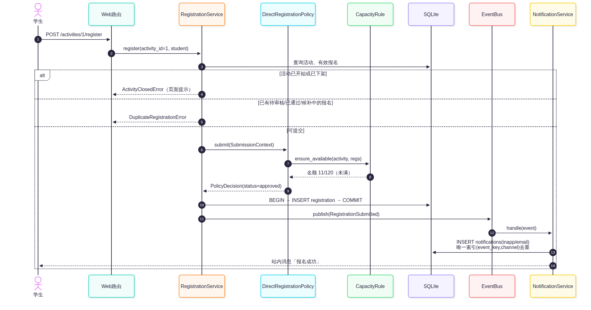
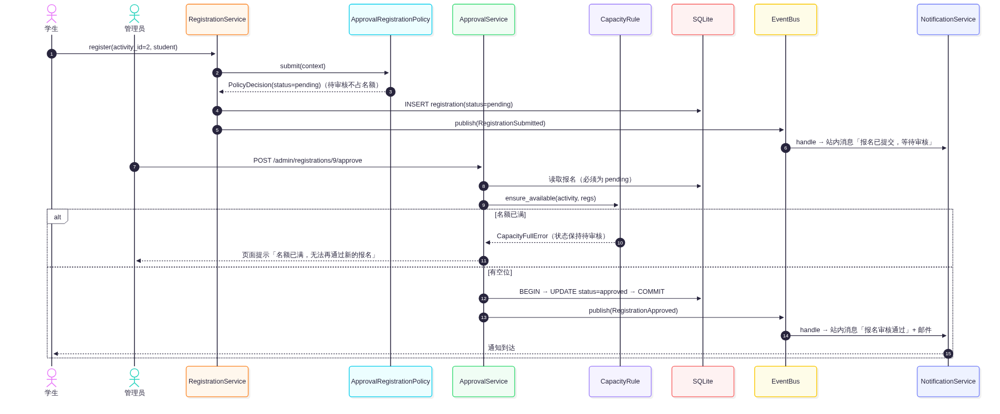
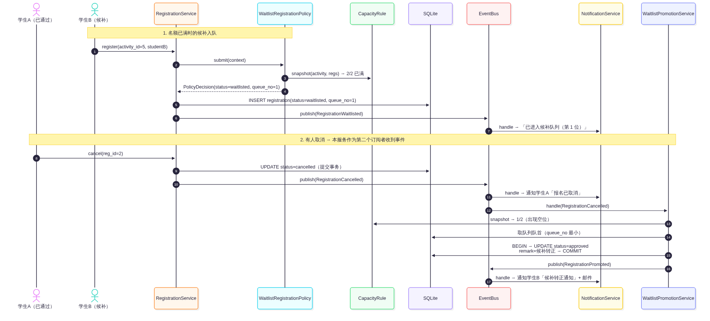

# 关键交互时序图

图由 `docs/diagrams/*.mmd` 生成，渲染脚本：`python tools/render_diagrams.py`。

## 1. 直接报名（提交即通过 + 事件通知）

要点：

1. 公共校验（活动可报名、无重复报名）在 `RegistrationService` 完成；
2. 准入语义由 `DirectRegistrationPolicy` 决定，名额检查复用 `CapacityRule`；
3. **报名事务先提交，事件后发布**——通知失败不会回滚报名；
4. 通知落库使用 `(event_key, channel)` 唯一索引，重复投递自动忽略。

## 2. 审核型报名与管理员审批

要点：

1. 提交阶段 `ApprovalRegistrationPolicy` 返回 `pending`，不查名额（待审核不占名额）；
2. 批准阶段 `ApprovalService` 调用**同一条** `CapacityRule` 二次检查，满员则拒绝且状态保持待审核；
3. 审批结果通过 `RegistrationApproved / RegistrationRejected` 事件通知学生。

## 3. 候补入队与自动转正（change-v2）

要点：

1. 满员时策略只负责“入队并给位次”，不改主流程；
2. 取消事件被两个订阅者消费：`NotificationService`（通知取消者）与 `WaitlistPromotionService`（转正队首）；
3. 转正同样走“事务提交 → 发布 `RegistrationPromoted` → 通知”的路径，保证一致；
4. 活动已开始时不再转正（与“活动开始后不再新增报名”保持一致，见 V5 测试）。
