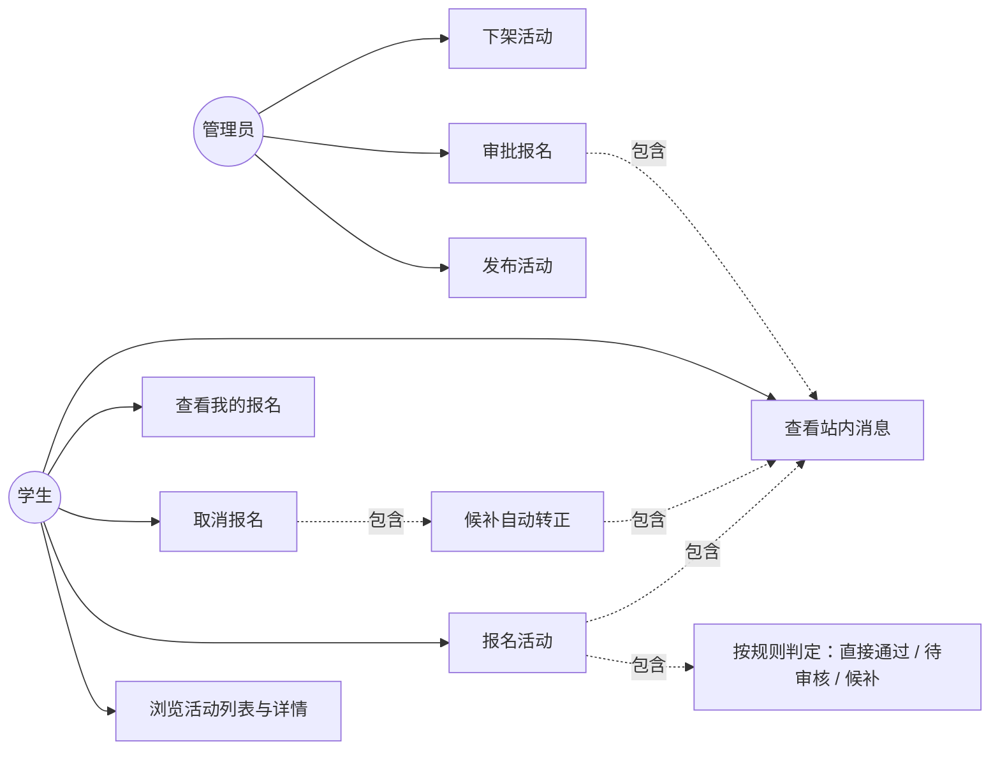
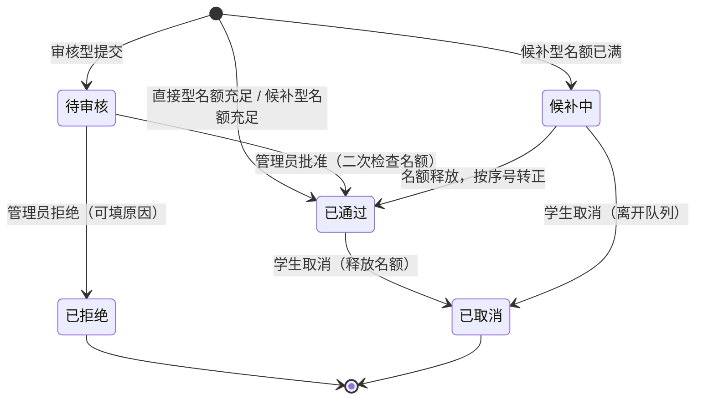

# 用例说明

## 1. 用例总览

## 2. 用例说明

### UC1 浏览活动列表与详情

| 项 | 内容 |
| --- | --- |
| 参与者 | 学生（未登录亦可浏览） |
| 前置条件 | 存在 `status='published'` 的活动 |
| 基本流 | 1. 打开首页 → 展示活动卡片：类别、规则标签、时间、地点、名额（已通过/上限） 2. 点击“查看详情” → 展示说明、名额、已通过名单、候补队列、我的报名记录 |
| 异常流 | 活动已开始 → 详情页提示“不再接受新报名” |
| 后置条件 | 无状态变更 |
| 对应测试 | T16、T17、V8 |

### UC2 报名活动（含两类/三类规则）

| 项 | 内容 |
| --- | --- |
| 参与者 | 已登录学生 |
| 前置条件 | 活动未开始、未下架；本人对该活动无有效报名 |
| 基本流 | 1. 在详情页点击报名 2. 系统按 `registration_mode` 选择策略 3. 直接报名 → 已通过并通知；审核报名 → 待审核并通知；候补报名 → 有名额则已通过，满员则候补第 N 位并通知 |
| 异常流 | 活动已开始/已下架 → 拒绝（`ActivityClosedError`） 已有待审核/已通过/候补中报名 → 拒绝（`DuplicateRegistrationError`） 直接报名且名额满 → 拒绝（`CapacityFullError`） |
| 后置条件 | 新增一条报名记录（状态由策略决定）；产生站内消息与邮件 |
| 对应测试 | T1、T2、T3、T6、T9、T10、V1、V4 |

### UC3 取消报名

| 项 | 内容 |
| --- | --- |
| 参与者 | 已登录学生 |
| 前置条件 | 该报名属于本人且状态为待审核/已通过/候补中 |
| 基本流 | 1. 在“我的报名”或详情页点击取消 2. 记录状态改为 `cancelled`，释放名额 3. 发送“报名已取消”通知 4. （v2）若存在候补队列且有席位，自动转正队首并通知 |
| 异常流 | 非本人 → 按“记录不存在”处理（不泄露他人信息） 已取消/已拒绝 → 拒绝重复取消 |
| 后置条件 | 报名状态变更；可能存在一条转正记录 |
| 对应测试 | T8、T14、V2 |

### UC4 查看我的报名 / UC5 查看站内消息

| 项 | 内容 |
| --- | --- |
| 参与者 | 已登录学生 |
| 基本流 | UC4：列出全部记录（含已取消/已拒绝历史），显示状态与候补位次；UC5：按时间倒序展示站内消息，未读红色角标，支持“全部标记已读” |
| 约束 | 同一业务事实只产生一条站内消息（`event_key + channel` 唯一） |
| 对应测试 | T12、T17、V3 |

### UC6 发布活动

| 项 | 内容 |
| --- | --- |
| 参与者 | 管理员 |
| 基本流 | 填写名称、类别、地点、开始时间、名额、报名规则 → 校验通过 → 发布，列表即时可见 |
| 异常流 | 名称为空/超长、名额非 1~10000 整数、开始时间早于当前、规则取值非法 → 中文提示且不落库 |
| 对应测试 | T16、V7（规则下拉含三种策略） |

### UC7 审批报名

| 项 | 内容 |
| --- | --- |
| 参与者 | 管理员 |
| 前置条件 | 存在 `pending` 报名 |
| 基本流 | 1. 后台查看待审核队列（含活动名额占用情况） 2. 批准 → 二次检查名额 → 改为已通过 → 通知学生 3. 拒绝 → 改为已拒绝（可填原因）→ 通知学生 |
| 异常流 | 名额已满 → 拒绝批准，状态保持待审核 重复审批 → `IllegalStatusTransitionError` |
| 对应测试 | T4、T5、T15、V6 |

### UC8 下架活动

| 项 | 内容 |
| --- | --- |
| 参与者 | 管理员 |
| 基本流 | 点击“下架（软删除）” → 活动不再出现在列表、不能报名；后台提示受影响的有效报名条数 |
| 后置条件 | 历史报名与通知全部保留，可审计 |
| 对应测试 | T10 |

## 3. 状态机（报名记录）

> 状态只用“目标状态 + 前置状态校验”的方式修改，避免出现“已拒绝 → 已通过”这类非法跳转。
